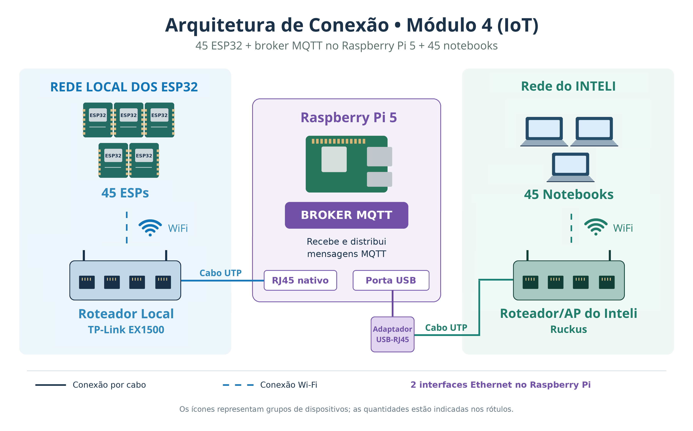
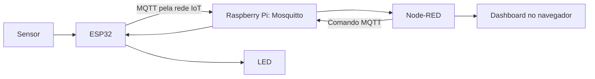

# Atendimento do Professor

## Terças e quintas. Professor de horário parcial. Nesses 2 dias, podem contar comigo!

# Semana 05 - Comunicação à distância

* Comunicação entre o microcontrolador e os blocos externos: Wi-Fi e protocolo MQTT no ESP32.
* Infraestrutura local de IoT: broker Mosquitto, Raspberry Pi 5 e Node-RED.
* Modelo TCP/IP: acesso à rede, Internet, transporte e aplicação. Envio de dados de sensores e controle de um LED pela rede local.

> **Perguntas aos grupos — Momento 1:** [Abrir as perguntas](perguntas.md#momento-1). Depois da discussão, use o link de retorno para continuar a explicação abaixo.

<a id="arquitetura"></a>

## Arquitetura da infraestrutura local

O Raspberry Pi 5 da sala executa o **Mosquitto**, broker MQTT responsável por encaminhar mensagens, e o **Node-RED**, ferramenta para processamento e visualização dos dados. O ESP32 conecta-se ao Wi-Fi isolado de IoT; o notebook acessa o Node-RED pela rede institucional. As duas interfaces de rede do Raspberry Pi atendem a esses ambientes.





O acesso ao dashboard pela rede institucional depende da configuração da sala; isso não significa que o broker esteja disponível pela Internet.

> **Perguntas aos grupos — Momento 2:** [Abrir as perguntas](perguntas.md#momento-2). Depois da discussão, use o link de retorno para continuar a explicação abaixo.

<a id="publicacao"></a>

## Funcionamento da comunicação MQTT

O ESP32 publica uma mensagem em um **tópico**. O broker a encaminha para clientes inscritos nesse tópico, como o Node-RED. Para enviar um comando ao ESP32, o fluxo é inverso: o Node-RED publica em um tópico de comando e o ESP32, inscrito nele, recebe a mensagem.

> **Perguntas aos grupos — Momento 3:** [Abrir as perguntas](perguntas.md#momento-3). Depois da discussão, use o link de retorno para continuar a explicação abaixo.

<a id="mosquitto"></a>

## O que acontece dentro do broker Mosquitto?

O **Mosquitto** é o programa que atua como broker MQTT no Raspberry Pi. Sua principal função é receber publicações dos clientes e encaminhá-las aos clientes interessados. Para compreender o percurso, imagine um ESP32 como publicador e o Node-RED como assinante.

> **Antes de começar:** os passos abaixo apresentam o funcionamento lógico de uma troca MQTT, tomando como referência o MQTT 3.1.1. Eles não são uma reprodução linha a linha do código-fonte interno do Mosquitto. Recursos como autenticação, permissões, persistência e limites dependem da configuração efetiva do broker da sala.

### Exemplo que vamos acompanhar

O ESP32 de ID `222`, pertencente à faixa do Grupo 3, envia uma leitura no tópico:

```text
inteli/iot/222/telemetria
```

O conteúdo da mensagem, chamado **payload**, pode ser um texto em formato JSON, por exemplo:

```json
{"device":222,"potenciometro":2048,"botao":0}
```

O Node-RED do grupo está inscrito nesse tópico para receber a telemetria. Em condições normais, o ESP32 chega ao Mosquitto pela rede IoT da sala, e o notebook acessa o editor e o dashboard do Node-RED pela rede do Inteli.

### Fluxo por etapas: da conexão à saída

1. **O ESP32 estabelece uma conexão de rede.** A placa conecta-se ao Wi-Fi `broker-f-iot` e abre uma conexão TCP com o endereço do Raspberry Pi na rede IoT, `192.168.10.2`, na porta MQTT `1883`. A conexão TCP é o caminho por onde os pacotes MQTT trafegam.

2. **O ESP32 se apresenta ao broker.** Pela conexão aberta, o cliente envia um pacote MQTT `CONNECT` com informações como versão do protocolo, identificador do cliente e parâmetros da sessão. Caso configuradas, credenciais também podem acompanhar a conexão. O Mosquitto verifica a validade da solicitação e, conforme sua configuração, autentica ou recusa o cliente. Ele responde com `CONNACK`, indicando se a conexão MQTT foi aceita. A senha do editor Node-RED não é automaticamente a senha MQTT.

3. **O Node-RED também se conecta e informa seu interesse.** Um node `mqtt in` funciona como cliente MQTT: depois de se conectar ao broker, envia um `SUBSCRIBE` com um filtro de tópico, por exemplo `inteli/iot/222/telemetria`, e o QoS máximo desejado. O Mosquitto registra a inscrição se ela for autorizada e responde com `SUBACK`, informando o resultado. Essa etapa pode ter ocorrido antes da publicação do ESP32.

4. **O ESP32 prepara os dados.** O sketch coleta as leituras e monta o payload. No exemplo, ele representa `device`, `potenciometro` e `botao` como texto JSON. A biblioteca acrescenta ao pacote MQTT o nome do tópico, o QoS de publicação e outras informações aplicáveis, como a indicação de mensagem retida. O payload não precisa ser JSON: MQTT pode transportar outros tipos de conteúdo em bytes.

5. **O Mosquitto recebe o pacote `PUBLISH`.** A partir do fluxo de dados recebido pela conexão TCP, o broker identifica o pacote MQTT e examina suas informações de protocolo, incluindo tópico, QoS, indicador de retenção e tamanho. O payload é a parte que contém os dados da aplicação. Os campos apresentados em um pacote dependem da versão do protocolo e do QoS utilizado.

6. **O broker verifica se a publicação é permitida.** O Mosquitto aplica a configuração disponível, como permissões de publicação no tópico, limites de tamanho e regras de autenticação ou autorização. Se uma verificação falhar, o tratamento depende da configuração e da versão do MQTT. Na arquitetura da aula, o fato de cada grupo ter uma instância de Node-RED própria não comprova, por si só, que há bloqueio entre tópicos no broker; isso depende das permissões configuradas nele.

7. **O broker trata o payload como dados da aplicação.** Na operação MQTT comum, o Mosquitto **não precisa interpretar o JSON** para encaminhar a mensagem: ele trabalha com o tópico e os metadados MQTT e transporta o conteúdo como uma sequência de bytes. Assim, ele não calcula a média do potenciômetro, não cria automaticamente variáveis e não verifica se `botao` é `0` ou `1`. Um JSON inválido pode ser encaminhado e só causar erro quando uma aplicação tentar interpretá-lo. Configurações, extensões ou aplicações específicas podem adicionar tratamento próprio.

> **Perguntas aos grupos — Momento 4:** [Abrir as perguntas](perguntas.md#momento-4). Depois da discussão, use o link de retorno para continuar a explicação abaixo.

<a id="topicos"></a>

8. **O broker procura inscrições compatíveis.** O Mosquitto compara o nome do tópico publicado com os filtros das inscrições registradas. Não é necessário existir uma lista prévia de tópicos criada manualmente: clientes autorizados podem publicar e se inscrever conforme a configuração do broker. Exemplos para a publicação `inteli/iot/222/telemetria`:

   * `inteli/iot/222/telemetria` → corresponde exatamente ao tópico.
   * `inteli/iot/+/telemetria` → corresponde, pois `+` substitui um nível, aqui o ID `222`.
   * `inteli/iot/#` → corresponde ao prefixo e aos níveis restantes.
   * `inteli/iot/223/telemetria` → não corresponde, pois o ID é diferente.

   Os curingas são usados em **filtros de inscrição**, não no nome do tópico enviado em uma publicação. Inscrever-se em tópicos de outros grupos só deve ocorrer se houver autorização e necessidade na atividade.

9. **O broker encaminha a mensagem.** Para cada assinante elegível cuja inscrição corresponda ao tópico, o Mosquitto prepara o envio por sua conexão MQTT. O Node-RED recebe uma nova publicação contendo o tópico e o payload. Se houver outros assinantes autorizados com filtros compatíveis, eles também podem receber a mensagem. Se nenhum assinante estiver conectado ou elegível, a publicação comum não cria automaticamente um histórico para consulta posterior; mensagens retidas e sessões persistentes podem alterar esse comportamento conforme as condições descritas abaixo.

10. **O QoS controla as confirmações.** Em QoS 0, não há confirmação MQTT de entrega; em QoS 1, o receptor confirma com `PUBACK`, e a mensagem pode ser entregue mais de uma vez; em QoS 2, há uma troca adicional de pacotes para garantir a entrega exatamente uma vez no âmbito do protocolo. O trecho ESP32 → broker e o trecho broker → Node-RED têm confirmações próprias. Na entrega a um assinante, o QoS não supera o QoS da publicação nem o máximo concedido à inscrição. Assim, uma publicação com QoS 0 permanece QoS 0 mesmo que o Node-RED peça QoS 1. A biblioteca `PubSubClient` dos exemplos publica em QoS 0.

11. **O Node-RED interpreta e usa os dados.** Após o recebimento, o node `mqtt in` disponibiliza o tópico em `msg.topic` e o payload em `msg.payload`. Conforme a configuração, o payload pode chegar como texto ou buffer. Um node `json` pode convertê-lo em objeto; depois, outro node acessa `msg.payload.potenciometro`, por exemplo. O fluxo pode exibir o valor em um medidor, alimentar um gráfico, executar uma regra ou enviar dados a um banco configurado separadamente.

12. **O caminho inverso também é possível.** Para acionar um LED, o Node-RED pode publicar `1` ou `0` em um tópico de comando, como `inteli/t29/grupo3/comando`. O Mosquitto verifica as inscrições compatíveis e encaminha o comando; o ESP32 inscrito interpreta o payload e altera o estado do GPIO. Receber uma confirmação MQTT não prova que o LED acendeu: essa verificação exige retorno de estado ou observação do circuito.

> **Perguntas aos grupos — Momento 5:** [Abrir as perguntas](perguntas.md#momento-5). Depois da discussão, use o link de retorno para continuar a explicação abaixo.

<a id="armazenamento"></a>

### O broker armazena as mensagens?

* **Mensagem comum:** o Mosquitto faz o encaminhamento conforme as inscrições e regras da sessão; ele não é automaticamente um banco de dados histórico.
* **Mensagem retida (`retain`):** quando publicada com essa opção e aceita pelo broker, a última mensagem retida de um tópico pode ser enviada a um novo assinante compatível. É útil para conhecer um último estado, mas não substitui um histórico. O comportamento e a persistência em disco dependem do QoS, da configuração e da operação do broker; não presuma que o recurso esteja habilitado ou sendo usado nos exemplos da aula.
* **Sessão persistente:** conforme versão do MQTT, parâmetros de sessão e configuração, o broker pode manter inscrições e enfileirar determinadas mensagens de QoS 1 ou 2 para um cliente temporariamente desconectado. Isso não significa guardar todas as mensagens para sempre.
* **Histórico de leituras:** para consultar dados antigos ou montar séries históricas duráveis, configure um serviço de armazenamento apropriado e um fluxo de gravação. O gráfico exibido pelo Node-RED também precisa de configuração adequada para preservar dados.

### Resumo do caminho dos dados

* **ESP32:** lê o sensor, monta o payload e publica no tópico MQTT.
* **Mosquitto:** recebe o pacote, verifica as regras aplicáveis, identifica as inscrições compatíveis e encaminha o payload.
* **Node-RED:** interpreta o conteúdo, processa os campos e apresenta os resultados.
* **Dashboard:** mostra a informação ao grupo pelo navegador conectado à rede do Inteli.

Referências técnicas: [Conceitos MQTT — Eclipse Mosquitto](https://mosquitto.org/man/mqtt-7.html) e [Especificação MQTT 3.1.1 — OASIS](https://docs.oasis-open.org/mqtt/mqtt/v3.1.1/os/mqtt-v3.1.1-os.html).

> **Perguntas aos grupos — Momento 6:** [Abrir as perguntas](perguntas.md#momento-6). Depois da discussão, use o link de retorno para continuar a explicação abaixo.

<a id="acesso"></a>

## Acesso à infraestrutura da T29

A T29 utiliza o **broker F**, exclusivo da turma. Todos os grupos da T29 usam esse broker, mas cada grupo tem sua própria instância do Node-RED e uma faixa de IDs para seus ESP32. Não use o broker nem os arquivos de outra turma.

| Grupo | Faixa de IDs dos ESP32 | Editor Node-RED | Dashboard |
|---|---|---|---|
| 1 | 206 a 213 | http://10.128.0.39:1871 | http://10.128.0.39:1871/ui |
| 2 | 214 a 221 | http://10.128.0.39:1872 | http://10.128.0.39:1872/ui |
| 3 | 222 a 229 | http://10.128.0.39:1873 | http://10.128.0.39:1873/ui |
| 4 | 230 a 237 | http://10.128.0.39:1874 | http://10.128.0.39:1874/ui |
| 5 | 238 a 245 | http://10.128.0.39:1875 | http://10.128.0.39:1875/ui |

Os endereços da tabela são para acesso pelo notebook na rede institucional do Inteli. O **editor** permite construir e alterar os fluxos; o **dashboard** apresenta a interface do projeto. Segundo as orientações da infraestrutura, o dashboard pode ser aberto sem senha: não exiba nele informações sensíveis. A instância de acompanhamento do professor é separada e restrita aos orientadores.

### Informações enviadas em privado ao grupo

O professor enviará no canal privado de cada grupo os dados da sua instância, incluindo **endereço do editor, endereço do dashboard, usuário, senha exclusiva e faixa de IDs**. Quando necessário, também orientará o grupo sobre a rede IoT e os arquivos de conexão. A senha do editor é para uso apenas pelos integrantes do próprio grupo: não a compartilhe com outras equipes, em canais abertos, imagens, vídeos, códigos ou repositórios. Não tente acessar ou alterar a instância de outro grupo. Se houver exposição da senha, avise o professor para que solicite a troca.

**Como usar os dados recebidos:**

1. No notebook conectado à rede institucional, abra o **editor** do seu grupo e informe o usuário e a senha recebidos em privado. Use essa instância para editar seus fluxos e publicar as alterações com **Deploy**.
2. Abra o endereço de **dashboard** do mesmo grupo no navegador para acompanhar a interface. O endereço termina em `/ui` e não é o endereço MQTT que deve ser usado no código.
3. Escolha um ID da faixa do seu grupo para cada ESP32. Cada placa ligada ao mesmo tempo deve ter um ID diferente. Informe esse ID no sketch da turma; ele identifica o dispositivo e compõe seu tópico de telemetria.
4. Utilize a pasta **`esp32_broker-f`** da T29, disponível nos [arquivos das turmas](https://drive.google.com/drive/folders/1yMFV9cq6ox71upvA42jXMI8lO3n-V_IV?usp=sharing), e siga a orientação do professor. Altere o ID passado a `InteliBroker.begin()` e não modifique `inteli_broker.h`. O cabeçalho contém a configuração da rede IoT da sala; as senhas individuais do editor Node-RED não fazem parte dele.
5. No Node-RED, configure o recebimento para o tópico do seu ESP32, por exemplo, `inteli/iot/222/telemetria` para o ID 222. Use a conexão MQTT já configurada na instância ou siga as informações fornecidas pelo professor. Na rede IoT, a porta MQTT é **1883**; as portas 1871 a 1875 são usadas pelo editor e dashboard, não pelo MQTT.

**Qual rede cada dispositivo usa?** O notebook do aluno deve permanecer, preferencialmente, na **rede do Inteli**. O ESP32 se conecta à rede local IoT `broker-f-iot`, criada pelo roteador da sala. O Raspberry Pi está ligado às duas redes por interfaces distintas; por isso, o endereço utilizado depende de onde está o dispositivo que acessa o serviço.

| Dispositivo e finalidade | Rede de conexão | Endereço utilizado |
|---|---|---|
| Notebook: acesso ao editor ou dashboard do grupo | Rede do Inteli, opção preferencial | `10.128.0.39` e a porta do grupo; adicione `/ui` para o dashboard. |
| ESP32: comunicação MQTT com o broker | Rede local IoT `broker-f-iot` | `192.168.10.2`, porta MQTT `1883`; essa configuração está no arquivo da turma. |
| Notebook: acesso diretamente pela rede IoT | Rede `broker-f-iot` da sala | `192.168.10.2` e a porta do grupo; alternativa apenas quando orientada pelo professor. |

`192.168.10.2` é o endereço da interface do Raspberry Pi na rede local IoT, não o endereço da rede em si nem o endereço habitual do notebook na rede do Inteli. Caso o acesso institucional apresente problemas, avise o professor; ele avaliará a alternativa de conexão direta ao roteador local. As credenciais do editor Node-RED permanecem restritas a cada grupo.

Se o ESP32 ou o dashboard não funcionar como esperado, consulte a seção **Diagnóstico e resolução de problemas**, após a parte prática.

## Exemplos

**Antes de começar:** obtenha com o professor o arquivo `inteli_broker.h`, o identificador único do ESP32, as informações da rede IoT, os endereços e a porta da instância Node-RED do grupo. Instale o suporte ao ESP32 e a biblioteca **PubSubClient**, do desenvolvedor **Nick O’Leary (knolleary)**, na Arduino IDE: abra **Ferramentas → Gerenciar Bibliotecas**, pesquise `PubSubClient`, confira o autor e selecione **Instalar**. Consulte a [documentação oficial da PubSubClient](https://pubsubclient.knolleary.net/). A biblioteca `WiFi.h` faz parte do pacote da placa ESP32. Não publique as senhas individuais de acesso ao editor Node-RED.

### Arquivo `inteli_broker.h` — configuração da T29

O cabeçalho a seguir contém a implementação informada pelo professor. Ele configura a conexão Wi-Fi e MQTT, publica a telemetria e tenta restabelecer a comunicação quando há falhas. O arquivo utilizado em sala é o da pasta `esp32_broker-f` e **não deve ser alterado pelos alunos**.

> **Atenção:** a senha da rede IoT consta no código da aula. As senhas individuais de acesso ao editor Node-RED continuam exclusivas de cada grupo e serão enviadas no canal privado.

```cpp
// ╔════════════════════════════════════════════╗
// ║  NÃO ALTERAR — configurado pelo professor  ║
// ╚════════════════════════════════════════════╝

#ifndef INTELI_BROKER_H
#define INTELI_BROKER_H

#include <WiFi.h>
#include <PubSubClient.h>
#include "freertos/FreeRTOS.h"
#include "freertos/task.h"

#define IB_WIFI_SSID   "broker-f-iot"
#define IB_WIFI_PASS   "tau2EAhwPsh2wJsGzpYU"
#define IB_BROKER_IP   "192.168.10.2"
#define IB_BROKER_PORT 1883
#define IB_TOPIC       "inteli/iot"
#define IB_INTERVAL_MS 5000

class _InteliBroker {
public:
    void begin(int deviceId) {
        _id  = deviceId;
        _seq = 0;
        _rc  = 0;
        snprintf(_topic, sizeof(_topic), "%s/%d/telemetria", IB_TOPIC, _id);
        _mqtt.setServer(IB_BROKER_IP, IB_BROKER_PORT);
        _mqtt.setKeepAlive(60);
        _mqtt.setSocketTimeout(10);
        _connectWifi();
        _connectMqtt();
    }

    void loop() {
        unsigned long now = millis();

        if (WiFi.status() != WL_CONNECTED) {
            if (!_wifiConnecting) {
                WiFi.disconnect(true);
                WiFi.mode(WIFI_STA);
                WiFi.begin(IB_WIFI_SSID, IB_WIFI_PASS);
                _wifiConnecting = true;
                _wifiStartMs    = now;
            }
            if (now - _wifiStartMs > 20000) ESP.restart();
            return;
        }
        if (_wifiConnecting) { _wifiConnecting = false; _rc++; }

        if (!_mqtt.connected()) {
            if (now - _mqttRetryMs >= 2000) {
                _mqttRetryMs = now;
                char cid[24];
                snprintf(cid, sizeof(cid), "esp-%d", _id);
                _mqtt.connect(cid);
            }
            return;
        }

        _mqtt.loop();
        if (now - _lastPub >= IB_INTERVAL_MS) _publish();
    }

    void send(String key, float value) {
        _extra += ",\"" + key + "\":" + String(value, 2);
    }
    void send(String key, int value) {
        _extra += ",\"" + key + "\":" + String(value);
    }
    void send(String key, String value) {
        _extra += ",\"" + key + "\":\"" + value + "\"";
    }

private:
    WiFiClient    _wifiClient;
    PubSubClient  _mqtt{_wifiClient};
    int           _id = 0;
    unsigned long _seq = 0, _rc = 0, _lastPub = 0;
    unsigned long _wifiStartMs = 0, _mqttRetryMs = 0;
    bool          _wifiConnecting = false;
    char          _topic[64];
    String        _extra = "";

    void _publish() {
        _lastPub = millis();
        if (!_mqtt.connected()) return;
        _seq++;
        char buf[256];
        snprintf(buf, sizeof(buf),
            "{\"device\":%d,\"seq\":%lu,\"rssi\":%ld,\"uptime_ms\":%lu,\"reconnects\":%lu%s}",
            _id, _seq, (long)WiFi.RSSI(), millis(), _rc, _extra.c_str());
        _mqtt.publish(_topic, buf);
        _extra = "";
    }

    void _connectWifi() {
        WiFi.disconnect(true);
        WiFi.mode(WIFI_STA);
        WiFi.begin(IB_WIFI_SSID, IB_WIFI_PASS);
        unsigned long t = millis();
        while (WiFi.status() != WL_CONNECTED) {
            if (millis() - t > 30000) ESP.restart();
            vTaskDelay(100 / portTICK_PERIOD_MS);
        }
        _rc++;
    }

    void _connectMqtt() {
        char cid[24];
        snprintf(cid, sizeof(cid), "esp-%d", _id);
        unsigned long t = millis(), lastTry = 0;
        while (!_mqtt.connected()) {
            if (millis() - t > 10000) ESP.restart();
            if (millis() - lastTry >= 500) {
                lastTry = millis();
                _mqtt.connect(cid);
            }
            vTaskDelay(100 / portTICK_PERIOD_MS);
        }
    }
};

_InteliBroker InteliBroker;

#endif
```

#### Como o arquivo funciona

* As diretivas `#ifndef`, `#define` e `#endif` evitam inclusões repetidas do cabeçalho.
* `IB_WIFI_SSID` e `IB_WIFI_PASS` identificam a rede local IoT; o endereço `192.168.10.2` é usado pelo ESP32 nessa rede. O notebook usa preferencialmente a rede do Inteli para acessar o Node-RED.
* `begin(deviceId)` registra o ID, monta o tópico `inteli/iot/<ID>/telemetria` e inicia as conexões. Para o ID 222, o tópico é `inteli/iot/222/telemetria`.
* `loop()` acompanha o Wi-Fi e o MQTT, tenta reconectar quando necessário e chama a publicação a cada `5000` ms enquanto a comunicação estiver disponível.
* `send(chave, valor)` acrescenta um campo para a próxima publicação; ele não publica imediatamente. O cabeçalho também informa `device`, `seq`, `rssi`, `uptime_ms` e `reconnects`.
* O código apresentado implementa publicação; ele não oferece um método público de assinatura de tópicos para receber comandos.

#### Código principal `.ino`

Mantenha o arquivo `.ino` e o `inteli_broker.h` fornecido pelo professor na mesma pasta do projeto. No exemplo, o ID `222` é da faixa do Grupo 3. Cada aluno deve usar um ID livre da faixa do seu próprio grupo.

```cpp
#include "inteli_broker.h"  // Usa o arquivo completo fornecido para a T29.

void setup() {
  Serial.begin(115200);
  InteliBroker.begin(222); // Escolha um ID livre na faixa do seu grupo.
}

void loop() {
  InteliBroker.loop(); // Mantém a conexão e cuida da publicação periódica.
}
```

Esse exemplo mínimo publica a telemetria padrão do cabeçalho e **não faz leitura de sensor por si só**. Para adicionar um potenciômetro e um botão, consulte o exemplo complementar a seguir.

### (1) Código para enviar dados ao broker local

Salve `inteli_broker.h` fornecido pelo professor na mesma pasta do sketch. Não altere esse arquivo. O exemplo usa o ID `222`, pertencente ao Grupo 3 da T29. Substitua-o por um ID disponível da faixa do seu grupo; não repita um ID que outra placa já esteja usando. O exemplo lê um potenciômetro no GPIO 34 e um botão no GPIO 33, configurado com resistor interno de pull-up. Ligue o botão entre GPIO 33 e GND; no exemplo, pressionado equivale a 1.

```cpp
#include "inteli_broker.h"

const int ID_DISPOSITIVO = 222; // ID único informado pelo professor
const int PINO_POTENCIOMETRO = 34;
const int PINO_BOTAO = 33;
unsigned long ultimaLeitura = 0;
const unsigned long INTERVALO_LEITURA = 5000;

void setup() {
  Serial.begin(115200);
  pinMode(PINO_POTENCIOMETRO, INPUT);
  pinMode(PINO_BOTAO, INPUT_PULLUP);
  InteliBroker.begin(ID_DISPOSITIVO);
}

void loop() {
  // Adiciona uma leitura antes de o serviço publicar a mensagem.
  if (millis() - ultimaLeitura >= INTERVALO_LEITURA) {
    ultimaLeitura = millis();
    int potenciometro = analogRead(PINO_POTENCIOMETRO);
    int botao = digitalRead(PINO_BOTAO) == LOW ? 1 : 0;
    InteliBroker.send("potenciometro", potenciometro);
    InteliBroker.send("botao", botao);
    Serial.printf("Potenciometro: %d | Botao: %d\n", potenciometro, botao);
  }
  InteliBroker.loop();
}
```

Com a configuração descrita no material, a publicação ocorre a cada 5 segundos no tópico `inteli/iot/222/telemetria`, quando o ID é 222. O JSON inclui os campos de telemetria da biblioteca e os valores adicionados com `send()`. Os campos extras são esvaziados após cada publicação; evite acrescentar repetidamente o mesmo campo entre duas publicações. Para testar, inscreva um node **mqtt in** nesse tópico e conecte-o a um **debug**.

> Use alimentação e tensão compatíveis com o ESP32: a entrada analógica não deve receber tensão acima de 3,3 V. Confira a pinagem da sua placa.

### (2) Código para receber comandos e acender um LED

O arquivo `inteli_broker.h` apresentado no material automatiza a publicação, mas **não oferece um método de inscrição em tópicos**. Por isso, este exemplo independente usa `WiFi.h` e `PubSubClient` diretamente; não inclua `inteli_broker.h` no mesmo sketch. Solicite ao professor os dados da rede IoT e a configuração de autenticação do broker. Este exemplo usa a configuração direta somente com autorização do professor; a senha do editor Node-RED não deve ser colocada no código do ESP32. O exemplo abaixo pressupõe que o broker aceite conexão sem usuário e senha; se exigir autenticação MQTT, ajuste a conexão conforme as instruções do professor.

Monte um LED externo: GPIO 2 → resistor de 330 Ω → ânodo do LED; cátodo → GND. Confira a pinagem da placa. No Node-RED, publique texto `1` ou `0` no tópico de comando do grupo. Ajuste o nome do tópico e `CLIENTE_ID` ao seu grupo e dispositivo. Para testar, preencha a senha da rede IoT indicada no cabeçalho; ela é diferente da senha particular do editor Node-RED.

```cpp
#include <WiFi.h>
#include <PubSubClient.h>

const char* WIFI_SSID = "broker-f-iot";
const char* WIFI_SENHA = "SENHA_REDE_IOT";
const char* BROKER_IP = "192.168.10.2"; // confirme o endereço com o professor
const int BROKER_PORTA = 1883;
const char* CLIENTE_ID = "esp32-grupo3-comando"; // único no broker
const char* TOPICO_COMANDO = "inteli/t29/grupo3/comando";
const int PINO_LED = 2;

WiFiClient rede;
PubSubClient mqtt(rede);
unsigned long ultimaTentativa = 0;

void aoReceber(char* topico, byte* payload, unsigned int tamanho) {
  String mensagem;
  for (unsigned int i = 0; i < tamanho; i++) mensagem += (char)payload[i];
  mensagem.trim();
  if (mensagem == "1") digitalWrite(PINO_LED, HIGH);
  else if (mensagem == "0") digitalWrite(PINO_LED, LOW);
  else { Serial.println("Comando invalido: use 0 ou 1"); return; }
  Serial.printf("Topico: %s | Comando: %s\n", topico, mensagem.c_str());
}

void setup() {
  Serial.begin(115200);
  pinMode(PINO_LED, OUTPUT);
  digitalWrite(PINO_LED, LOW);
  WiFi.mode(WIFI_STA);
  WiFi.begin(WIFI_SSID, WIFI_SENHA);
  mqtt.setServer(BROKER_IP, BROKER_PORTA);
  mqtt.setCallback(aoReceber);
}

void loop() {
  if (WiFi.status() != WL_CONNECTED) return;
  if (!mqtt.connected() && millis() - ultimaTentativa >= 2000) {
    ultimaTentativa = millis();
    if (mqtt.connect(CLIENTE_ID)) mqtt.subscribe(TOPICO_COMANDO, 1);
  }
  mqtt.loop();
}
```

Após reconectar ao broker, o sketch refaz a inscrição. A primeira tentativa de conexão MQTT ocorre até dois segundos após iniciar. O ESP32 e o broker precisam estar alcançáveis pela rede IoT. As credenciais de acesso ao editor Node-RED não são necessariamente credenciais MQTT.

### (3) Juntando envio e recebimento de dados

Este sketch independente também usa `PubSubClient` diretamente, pois o cabeçalho apresentado não implementa assinatura. Ajuste rede, IP, ID e tópicos conforme a sala. Ele publica um JSON com potenciômetro e botão e recebe comandos para o LED. Não utilize este exemplo simultaneamente ao exemplo 1 no mesmo ESP32.

```cpp
#include <WiFi.h>
#include <PubSubClient.h>

const char* WIFI_SSID = "broker-f-iot";
const char* WIFI_SENHA = "SENHA_REDE_IOT";
const char* BROKER_IP = "192.168.10.2"; // confirme o endereço com o professor
const int BROKER_PORTA = 1883;
const char* CLIENTE_ID = "esp32-grupo3-completo"; // único no broker
const char* TOPICO_DADOS = "inteli/iot/222/telemetria";
const char* TOPICO_COMANDO = "inteli/t29/grupo3/comando";
const int ID_DISPOSITIVO = 222;
const int PINO_POTENCIOMETRO = 34, PINO_BOTAO = 33, PINO_LED = 2;
const unsigned long INTERVALO = 5000;
unsigned long ultimaPublicacao = 0, ultimaTentativa = 0;
WiFiClient rede;
PubSubClient mqtt(rede);

void aoReceber(char* topico, byte* payload, unsigned int tamanho) {
  String mensagem;
  for (unsigned int i = 0; i < tamanho; i++) mensagem += (char)payload[i];
  mensagem.trim();
  if (mensagem == "1") digitalWrite(PINO_LED, HIGH);
  else if (mensagem == "0") digitalWrite(PINO_LED, LOW);
  else { Serial.println("Comando invalido"); return; }
  Serial.printf("Topico: %s | Comando: %s\n", topico, mensagem.c_str());
}

void setup() {
  Serial.begin(115200);
  pinMode(PINO_POTENCIOMETRO, INPUT);
  pinMode(PINO_BOTAO, INPUT_PULLUP);
  pinMode(PINO_LED, OUTPUT);
  digitalWrite(PINO_LED, LOW);
  WiFi.mode(WIFI_STA);
  WiFi.begin(WIFI_SSID, WIFI_SENHA);
  mqtt.setServer(BROKER_IP, BROKER_PORTA);
  mqtt.setCallback(aoReceber);
}

void loop() {
  if (WiFi.status() != WL_CONNECTED) return;
  if (!mqtt.connected() && millis() - ultimaTentativa >= 2000) {
    ultimaTentativa = millis();
    if (mqtt.connect(CLIENTE_ID)) mqtt.subscribe(TOPICO_COMANDO, 1);
  }
  if (!mqtt.connected()) return;
  mqtt.loop();
  if (millis() - ultimaPublicacao >= INTERVALO) {
    ultimaPublicacao = millis();
    char mensagem[128];
    snprintf(mensagem, sizeof(mensagem),
      "{\"device\":%d,\"potenciometro\":%d,\"botao\":%d}",
      ID_DISPOSITIVO, analogRead(PINO_POTENCIOMETRO),
      digitalRead(PINO_BOTAO) == LOW ? 1 : 0);
    if (mqtt.publish(TOPICO_DADOS, mensagem)) Serial.println(mensagem);
    else Serial.println("Falha ao publicar");
  }
}
```

O ID 222 e o tópico de comando são exemplos para o Grupo 3: ajuste-os à faixa e ao tópico do seu grupo, usando um `CLIENTE_ID` único por placa. O JSON deste exemplo é simplificado: ele não acrescenta automaticamente os campos `seq`, `rssi`, `uptime_ms` e `reconnects` da biblioteca do professor. Se a estrutura do grupo depender desses campos, combine a adaptação com o professor. A publicação usando `PubSubClient.publish()` ocorre em **QoS 0**; a inscrição acima solicita QoS 1, mas a entrega depende também do QoS da publicação. Para publicar em QoS 1, é necessária uma biblioteca MQTT com suporte a esse recurso ou outra implementação aprovada pelo professor.

# Teoria Completa

# Comunicação à Distância

A comunicação ocorre quando ESP32, broker e aplicação trocam mensagens por uma rede. Nesta aula, usamos uma rede local: o ESP32 coleta dados, o Mosquitto os encaminha e o Node-RED os apresenta ou processa. O mesmo caminho permite que uma aplicação envie comandos ao microcontrolador.

## Arquitetura do projeto com broker local

* **ESP32:** conecta sensores e atuadores à rede Wi-Fi IoT e atua como cliente MQTT.
* **Raspberry Pi 5:** computador da sala conectado à rede IoT pela interface Ethernet nativa e à rede institucional por adaptador Ethernet USB.
* **Mosquitto:** broker que recebe publicações e as distribui aos clientes inscritos.
* **Node-RED:** ambiente de programação visual que recebe e processa mensagens, cria painéis e publica comandos.
* **Notebook:** acessa a instância do grupo no Node-RED usando a rede institucional.

A infraestrutura local permite trabalhar dentro da rede da sala, com autonomia de configuração e baixa latência. Disponibilidade, segurança e capacidade dependem da configuração e administração do ambiente. Um broker MQTT, por si só, **não é um banco de dados nem cria dashboards**: persistência, visualização e regras precisam ser implementadas nos serviços apropriados.

## Modelo TCP/IP e MQTT

| Camada | Papel na prática |
|---|---|
| Acesso à rede | O Wi-Fi conecta o ESP32 à rede do roteador IoT. |
| Internet | O IP identifica dispositivos e permite encaminhar pacotes entre redes configuradas. |
| Transporte | O TCP mantém a conexão usada pelo MQTT; o broker da sala utiliza a porta 1883. |
| Aplicação | O MQTT organiza a publicação e a assinatura de mensagens por tópicos. |

A porta 1883 não garante criptografia. Autenticação, permissões e eventual TLS dependem da configuração informada pelo professor.

## Documentação da infraestrutura

[Infraestrutura IoT do Inteli — Broker MQTT e Node-RED](https://templates.pages.git.inteli.edu.br/primeiro-ano/in04/infraestrutura-iot-inteli/Infraestrutura_IoT.html)

Consulte o material do Inteli para obter detalhes de Node-RED, QoS, configuração do ambiente e biblioteca distribuída pelo professor.

## Diagrama de blocos do funcionamento

1. **Conexão à rede:** o ESP32 conecta-se ao Wi-Fi isolado do roteador IoT; o notebook utiliza a rede institucional.
2. **Identificação:** cada ESP32 usa um ID único. Com a biblioteca da aula, o ID compõe o tópico de telemetria.
3. **Leitura:** o firmware coleta os valores dos sensores.
4. **Publicação:** a biblioteca adiciona os valores à mensagem JSON e publica no Mosquitto; por exemplo, `inteli/iot/222/telemetria`.
5. **Distribuição:** o broker encaminha a mensagem aos clientes inscritos no tópico.
6. **Processamento e visualização:** um fluxo Node-RED recebe, transforma e exibe os dados no debug ou dashboard.
7. **Comando:** um fluxo Node-RED pode publicar em um tópico de comando; um ESP32 inscrito interpreta a mensagem e aciona o LED.
8. **Armazenamento e regras:** são opcionais e precisam ser configurados em componentes próprios ou fluxos do Node-RED.

### Dados da mensagem

O MQTT transporta um **payload**, cujo formato é definido pela aplicação. Na biblioteca da aula, a telemetria é enviada em JSON. Exemplo ilustrativo:

```json
{"device":222,"seq":42,"rssi":-55,"uptime_ms":210000,"reconnects":1,"potenciometro":2048,"botao":0}
```

`device` identifica o ESP32; `seq` é a sequência; `rssi` representa a intensidade do sinal Wi-Fi; `uptime_ms` é o tempo desde a inicialização, em milissegundos; e `reconnects` registra conexões na implementação fornecida. Os demais campos são adicionados pelo projeto. `uptime_ms` não é data e hora: se precisar de carimbo de tempo real, implemente a obtenção de horário e defina seu formato e unidade. Outros dados, como texto ou coordenadas, podem ser incluídos no JSON quando previstos pela aplicação.

### Tópicos e QoS

Tópicos organizam as mensagens hierarquicamente, como `inteli/iot/222/telemetria` e `inteli/t29/grupo3/comando`. Publicador e assinante precisam usar tópicos compatíveis. Na inscrição, `+` corresponde a um nível e `#` aos níveis restantes.

* **QoS 0:** no máximo uma entrega; mensagens podem se perder.
* **QoS 1:** pelo menos uma entrega; podem ocorrer duplicações.
* **QoS 2:** exatamente uma entrega no protocolo, com maior custo de comunicação.

O material do Inteli recomenda QoS 1 para o módulo. Entretanto, a biblioteca `PubSubClient` usada no cabeçalho apresentado publica em QoS 0; definir a inscrição como QoS 1 não eleva uma publicação QoS 0. Adeque a biblioteca caso o projeto exija outra garantia. A confirmação MQTT não substitui a verificação de que uma ação física foi executada.

## Parte prática

1. Receba em privado os dados do seu grupo e escolha um ID livre na faixa indicada na tabela da T29. Obtenha a pasta `esp32_broker-f` e o arquivo `inteli_broker.h`; não compartilhe as senhas.
2. Instale o pacote ESP32 e `PubSubClient`, de Nick O’Leary, pelo Gerenciador de Bibliotecas da Arduino IDE. Salve o cabeçalho na pasta do sketch e não altere seu conteúdo.
3. Monte o potenciômetro e o botão conforme o exemplo 1, respeitando o limite de 3,3 V do ESP32. Altere o ID no sketch, grave-o e acompanhe o monitor serial em 115200 baud.
4. No notebook conectado à rede institucional, acesse o editor Node-RED da T29 correspondente ao seu grupo, pela tabela acima, e entre com o usuário e a senha recebidos em privado. Não use os dados de outra equipe.
5. Na instância do grupo, configure `mqtt in` para o broker fornecido e tópico `inteli/iot/<ID>/telemetria`, substituindo `<ID>` pelo número do ESP32. Conecte-o a `debug` e clique em **Deploy**. Verifique a chegada dos dados.
6. Para montar um painel, use a estrutura pré-construída do grupo ou configure nodes de dashboard. O pacote `@flowfuse/node-red-dashboard` já vem instalado nas instâncias da sala segundo o material. Converta o JSON e selecione o campo antes de alimentar um medidor ou gráfico.
7. Para o LED, monte o circuito do exemplo 2 e grave seu sketch independente, após confirmar a configuração MQTT com o professor. Configure no Node-RED dois nodes `inject`, um enviando texto `1` e outro texto `0`, conectados a um `mqtt out` no mesmo tópico de comando do sketch. Faça **Deploy** e teste ambos. Depois, se desejar, substitua os nós `inject` por controles no dashboard.
8. O dashboard da sala é apresentado no material como `http://<IP>:<porta>/ui`; confirme o endereço efetivo com o professor. A página do editor usa a mesma porta sem `/ui`.

**Rede e acesso:** mantenha o notebook preferencialmente na rede do Inteli e acesse `10.128.0.39` com a porta do grupo. O endereço `192.168.10.2` pertence à interface do Raspberry Pi na rede IoT, utilizada pelo ESP32 e pelo notebook somente quando estiver conectado diretamente à rede local sob orientação. Os endereços são diferentes porque o Raspberry Pi possui duas interfaces. Se necessário, o Node-RED que roda no próprio Raspberry Pi poderá utilizar o endereço do broker configurado pelo administrador; não presuma que os IPs das duas redes sejam iguais.

> **Perguntas aos grupos — Momento 7:** [Abrir as perguntas](perguntas.md#momento-7). Depois da discussão, use o link de retorno para continuar a explicação abaixo.

<a id="diagnostico"></a>

## Diagnóstico e resolução de problemas

Depois de montar e testar o circuito, use este roteiro quando o ESP32, o broker ou o dashboard não funcionar como esperado. Siga o caminho dos dados para localizar a etapa com problema:

**Sensor → ESP32 → Wi-Fi IoT → Mosquitto → Node-RED → dashboard**

Comece pelas verificações que o grupo pode fazer no seu próprio ESP32 e na sua própria instância do Node-RED. Verificações do Raspberry Pi, serviços, roteador e rede institucional são responsabilidade do professor ou da equipe autorizada.

### 1. O ESP32 não aparece ou reinicia repetidamente

1. Confirme que a placa está energizada, que o cabo USB também transmite dados e que a placa e a porta corretas foram selecionadas na Arduino IDE.
2. Confirme que você usou a pasta **`esp32_broker-f`**, destinada à T29, e o `inteli_broker.h` fornecido para essa turma. Não modifique o cabeçalho para tentar corrigir a rede; consulte o professor caso suspeite de erro no arquivo.
3. Verifique se o ID informado em `InteliBroker.begin()` pertence à faixa do seu grupo e é diferente do ID usado por qualquer outra placa ligada. IDs MQTT duplicados podem provocar desconexões alternadas. Se usar os exemplos com `PubSubClient` diretamente, confira também se cada `CLIENTE_ID` é único.
4. Abra **Ferramentas → Monitor Serial** na Arduino IDE e selecione **115200 baud**. Observe mensagens de conexão ou reinicializações. O texto exibido depende do sketch e da versão da biblioteca: uma saída sem mensagens não confirma, por si só, uma falha de Wi-Fi. O código `b4` ou reinicializações repetidas podem indicar falha de conexão; confira o contexto exibido.
5. Verifique se a rede **`broker-f-iot`** está visível. Se não estiver, ou se o problema persistir, informe o professor. Nos exemplos que usam a conexão diretamente, confirme com o professor os dados da rede e do broker; não divulgue as senhas particulares dos grupos.

### 2. O ESP32 conecta ao Wi-Fi, mas não ao MQTT

A conexão Wi-Fi e a conexão ao broker são etapas diferentes. Nos exemplos que exibem esses estados, um IP recebido pelo ESP32 indica conexão à rede, mas não comprova que o MQTT esteja conectado.

* Confirme que o ESP32 está usando a rede IoT da T29, não a rede institucional do notebook.
* Nos exemplos com `PubSubClient` diretamente, confira o endereço da interface IoT do broker, `192.168.10.2`, e a porta MQTT `1883`. Com `inteli_broker.h`, use o arquivo da T29 sem alterá-lo e solicite ajuda caso haja dúvida sobre a configuração.
* Se o programa informar um código de falha de conexão MQTT, registre-o e avise o professor. Em `PubSubClient`, por exemplo, `-2` indica falha na conexão de rede, `-4` indica tempo de resposta esgotado e `5` indica conexão não autorizada; esses códigos não determinam sozinhos a causa exata.
* Se a falha continuar, o professor poderá verificar o Mosquitto, a rede e o roteador.

### 3. O ESP32 conecta, mas os dados não chegam ao dashboard

1. Abra o editor do **seu grupo** e localize o node `mqtt in`. Verifique se ele indica conexão ativa com o broker. Caso não esteja conectado, peça orientação ao professor antes de mudar a configuração compartilhada do fluxo.
2. Confira se o tópico inscrito corresponde ao ID gravado. Por exemplo, para o ID **222**, o tópico é `inteli/iot/222/telemetria`; outro ID exige o número correspondente no tópico.
3. Conecte a saída do `mqtt in` a um node `debug`, selecione a aba **Debug** e clique em **Deploy**. Aguarde pelo menos um intervalo de publicação e verifique se o payload aparece. No exemplo padrão, a biblioteca publica aproximadamente a cada cinco segundos enquanto estiver conectada.
4. Se a mensagem aparece no `debug`, mas não no dashboard, verifique se o JSON foi convertido em objeto, se o campo correto foi selecionado, se o widget pertence à página e ao grupo esperados e se o fluxo foi implantado. Para um medidor, confira também se o valor recebido é numérico.
5. Se a mensagem não aparece no `debug`, registre o ID e o tópico e peça ao professor para verificar se ela chegou ao broker.

### 4. O dashboard não abre, está vazio ou o editor rejeita o acesso

* **Página não abre:** confira se o notebook está na rede institucional, se o endereço usa `10.128.0.39` e se a porta corresponde ao seu grupo. O editor usa `http://10.128.0.39:PORTA`; o dashboard da sala usa `http://10.128.0.39:PORTA/ui`. Substitua `PORTA` pela porta informada na tabela da T29. Se a falha continuar, avise o professor.
* **Dashboard abre vazio:** confirme que está no endereço do seu grupo; no editor, veja se os nodes de interface estão conectados e configurados e se as alterações foram publicadas com **Deploy**. O professor poderá verificar a instalação e a configuração do dashboard.
* **Login rejeitado:** confira o usuário e a senha recebidos em privado, respeitando maiúsculas e minúsculas, e verifique se abriu o editor do grupo correto. Não envie a senha em canal aberto. Se o problema continuar, procure o professor; a configuração de autenticação deve ser verificada pela equipe responsável.
* **Caminho da interface:** nas instâncias da sala, o material indica `/ui`. Se o ambiente tiver configuração diferente, confirme o endereço com o professor; `/dashboard` pode ser usado em outras instalações, mas não deve ser presumido para a T29.

### 5. O LED não responde ao comando

1. Confira a montagem: GPIO correto, resistor em série, polaridade do LED e GND. Desligue a alimentação antes de alterar as conexões.
2. Verifique se o ESP32 está conectado ao broker e se o tópico publicado pelo Node-RED é exatamente o mesmo ao qual o ESP32 está inscrito. Depois de editar o fluxo, clique em **Deploy**.
3. Nos exemplos deste material, envie o texto `1` para ligar e `0` para desligar; outros valores são rejeitados. Acompanhe o Monitor Serial para identificar o comando recebido.
4. Após uma queda de conexão, confira se o sketch refez a inscrição. Se houver dúvida, teste o fluxo usando `inject → mqtt out` e peça apoio ao professor.

### 6. Informações para pedir ajuda

Informe ao professor **o grupo, o ID do ESP32, a etapa que falhou, o tópico utilizado, a mensagem de erro e o que já foi testado**. Uma captura do Monitor Serial ou do `debug` pode ajudar, desde que não mostre senhas, credenciais ou informações de outros grupos.

### Apoio ao professor: diagnóstico da infraestrutura

O guia completo também apresenta procedimentos para Mosquitto, Node-RED, SSH, roteador, serviços após reinicialização e desempenho. Esses passos são destinados ao professor ou à equipe autorizada, pois uma alteração no Raspberry Pi ou roteador pode afetar a turma inteira. Não compartilhe acesso administrativo ou credenciais com os alunos.

Para o broker F, com o notebook conectado à rede institucional e acesso autorizado, as verificações abaixo são exemplos **de leitura** no Raspberry Pi:

```bash
# Estado do Mosquitto e da instância do grupo 3
systemctl status mosquitto
systemctl status nodered-grupo3

# Interfaces e portas (MQTT e editor do grupo 3)
ip addr show eth0
ip addr show eth1
ss -tln | grep -E '1883|1873'

# Últimos eventos do broker e da instância do grupo 3
journalctl -u mosquitto -n 30 --no-pager
journalctl -u nodered-grupo3 -n 30 --no-pager
```

O grupo 3 e a porta 1873 são exemplos; substitua pelo grupo e porta correspondentes. O acesso aos logs pode depender das permissões da conta. Se as mensagens chegam ao Mosquitto, mas não ao dashboard, verifique o fluxo e o serviço da instância. Antes de reiniciar serviços, restaurar backups, instalar pacotes ou alterar rede e autenticação, avalie o impacto nos grupos e siga os procedimentos administrativos da instituição.

Para aprofundar o diagnóstico, consulte o **Troubleshooting — Brokers IoT Inteli**, de André Godoi e Vinicius Hiroshi, fornecido como material de apoio. O guia inclui testes MQTT, roteador, conectividade SSH, recuperação de fluxos, recursos do Raspberry Pi e verificação de serviços após reinicialização.

## Comentário do código

* `InteliBroker.begin(ID_DISPOSITIVO)` configura e inicia a conexão usando o arquivo distribuído pelo professor.
* `InteliBroker.send("potenciometro", valor)` acrescenta um campo à próxima telemetria; não envia a mensagem imediatamente.
* `InteliBroker.loop()` mantém a conexão e publica periodicamente conforme o intervalo da biblioteca. Deve ser chamado repetidamente no `loop()`.
* No exemplo de comando, `mqtt.subscribe(...)` inscreve o ESP32 no tópico e `aoReceber(...)` interpreta o payload recebido. Depois de uma reconexão, é necessário refazer a inscrição.

## Onde publicar as variáveis e seus valores usando MQTT?

Com a biblioteca da aula, adicione um campo para cada leitura antes da próxima publicação:

```cpp
InteliBroker.send("temperatura", temperatura);
InteliBroker.send("umidade", umidade);
InteliBroker.loop();
```

Os campos são agrupados no JSON publicado em `inteli/iot/<ID>/telemetria`; o broker distribui a mensagem aos assinantes. No Node-RED, use `mqtt in`, converta o JSON para objeto e selecione cada propriedade. O MQTT não cria variáveis, dashboards ou histórico automaticamente.

## Referência da Prática

[Infraestrutura IoT do Inteli — Broker MQTT e Node-RED](https://templates.pages.git.inteli.edu.br/primeiro-ano/in04/infraestrutura-iot-inteli/Infraestrutura_IoT.html), material de André Godoi e Vinicius Hiroshi, outubro de 2026.

> **Perguntas aos grupos — Fechamento:** [Abrir as perguntas](perguntas.md#fechamento). Depois da discussão, use o link de retorno para continuar a explicação abaixo.

<a id="conclusoes"></a>

## Conclusões sobre o MQTT

Cada grupo deve descrever o que aprendeu sobre publicação, assinatura, tópicos e o papel do broker local, incluindo como o Node-RED participa da comunicação. Registre a conclusão no espaço indicado pelo professor.
