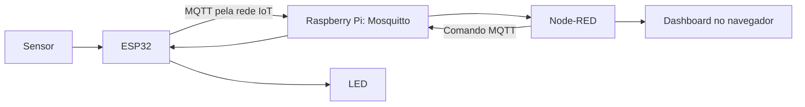

# Atendimento do Professor

## Terças e quintas. Professor de horário parcial. Nesses 2 dias, podem contar comigo!

# Semana 05 - Comunicação à distância (Semana de Ponderada)

* Comunicação entre o microcontrolador e os blocos externos: Wi-Fi e protocolo MQTT no ESP32.
* Infraestrutura local de IoT: broker Mosquitto, Raspberry Pi 5 e Node-RED.
* Modelo TCP/IP: acesso à rede, Internet, transporte e aplicação. Envio de dados de sensores e controle de um LED pela rede local.

## Arquitetura da infraestrutura local

O Raspberry Pi 5 da sala executa o **Mosquitto**, broker MQTT responsável por encaminhar mensagens, e o **Node-RED**, ferramenta para processamento e visualização dos dados. O ESP32 conecta-se ao Wi-Fi isolado de IoT; o notebook acessa o Node-RED pela rede institucional. As duas interfaces de rede do Raspberry Pi atendem a esses ambientes.



O acesso ao dashboard pela rede institucional depende da configuração da sala; isso não significa que o broker esteja disponível pela Internet.

## Funcionamento da comunicação MQTT

O ESP32 publica uma mensagem em um **tópico**. O broker a encaminha para clientes inscritos nesse tópico, como o Node-RED. Para enviar um comando ao ESP32, o fluxo é inverso: o Node-RED publica em um tópico de comando e o ESP32, inscrito nele, recebe a mensagem.

## Acesso à infraestrutura da T29

A T29 utiliza o **broker F**, exclusivo da turma. Todos os grupos da T29 usam esse broker, mas cada grupo tem sua própria instância do Node-RED e uma faixa de IDs para seus ESP32. Não use o broker nem os arquivos de outra turma.

| Grupo | Faixa de IDs dos ESP32 | Editor Node-RED | Dashboard |
|---|---|---|---|
| 1 | 206 a 213 | http://10.128.0.39:1871 | http://10.128.0.39:1871/ui |
| 2 | 214 a 221 | http://10.128.0.39:1872 | http://10.128.0.39:1872/ui |
| 3 | 222 a 229 | http://10.128.0.39:1873 | http://10.128.0.39:1873/ui |
| 4 | 230 a 237 | http://10.128.0.39:1874 | http://10.128.0.39:1874/ui |
| 5 | 238 a 245 | http://10.128.0.39:1875 | http://10.128.0.39:1875/ui |

Os endereços da tabela são para acesso pelo notebook na rede institucional do Inteli. O **editor** permite construir e alterar os fluxos; o **dashboard** apresenta a interface do projeto. Segundo as orientações da infraestrutura, o dashboard pode ser aberto sem senha: não exiba nele informações sensíveis. A instância de acompanhamento do professor é separada e restrita aos orientadores.

### Informações enviadas em privado ao grupo

O professor enviará canal privado de cada grupo os dados da sua instância, incluindo **endereço do editor, endereço do dashboard, usuário, senha exclusiva e faixa de IDs**. Quando necessário, também orientará o grupo sobre a rede IoT e os arquivos de conexão. A senha do editor é para uso apenas pelos integrantes do próprio grupo: não a compartilhe com outras equipes, em canais abertos, imagens, vídeos, códigos ou repositórios. Não tente acessar ou alterar a instância de outro grupo. Se houver exposição da senha, avise o professor para que solicite a troca.

**Como usar os dados recebidos:**

1. No notebook conectado à rede institucional, abra o **editor** do seu grupo e informe o usuário e a senha recebidos em privado. Use essa instância para editar seus fluxos e publicar as alterações com **Deploy**.
2. Abra o endereço de **dashboard** do mesmo grupo no navegador para acompanhar a interface. O endereço termina em `/ui` e não é o endereço MQTT que deve ser usado no código.
3. Escolha um ID da faixa do seu grupo para cada ESP32. Cada placa ligada ao mesmo tempo deve ter um ID diferente. Informe esse ID no sketch da turma; ele identifica o dispositivo e compõe seu tópico de telemetria.
4. Utilize a pasta **`esp32_broker-f`** da T29, disponível nos [arquivos das turmas](https://drive.google.com/drive/folders/1yMFV9cq6ox71upvA42jXMI8lO3n-V_IV?usp=sharing), e siga a orientação do professor. Altere o ID passado a `InteliBroker.begin()` e não modifique `inteli_broker.h`. O cabeçalho contém a configuração da sala e deve ser tratado como arquivo sensível; não o publique no GitHub se contiver credenciais.
5. No Node-RED, configure o recebimento para o tópico do seu ESP32, por exemplo, `inteli/iot/222/telemetria` para o ID 222. Use a conexão MQTT já configurada na instância ou siga as informações fornecidas pelo professor. Na rede IoT, a porta MQTT é **1883**; as portas 1871 a 1875 são usadas pelo editor e dashboard, não pelo MQTT.

**Redes diferentes:** o ESP32 conecta-se à rede IoT da T29, `broker-f-iot`, usando a configuração do arquivo fornecido. O notebook normalmente acessa o Node-RED pelo Wi-Fi institucional. O endereço `10.128.0.39` é o acesso pela rede institucional; o endereço da interface IoT no material é `192.168.10.2`. Confirme o acesso e qualquer configuração especial com o professor. Se o endereço institucional estiver indisponível, procure o professor para verificar a alternativa pela rede IoT; não compartilhe publicamente a senha dessa rede.

### Se o ESP32 não aparecer

* Confira se o sketch e o cabeçalho são da pasta `esp32_broker-f` da T29.
* Confira se o ID está na faixa do seu grupo e se outra placa não usa o mesmo número. IDs duplicados podem causar desconexões repetidas; o tempo de funcionamento pode voltar a zero.
* Veja se o tópico inscrito no `mqtt in` corresponde exatamente ao ID gravado e se o fluxo recebeu **Deploy**.
* Verifique a conexão e o endereço do broker configurado com a orientação do professor. Se o problema persistir, peça ao professor para conferir o painel de acompanhamento da turma.

## Exemplos

**Antes de começar:** obtenha com o professor o arquivo `inteli_broker.h`, o identificador único do ESP32, as informações da rede IoT, os endereços e a porta da instância Node-RED do grupo. Instale o suporte ao ESP32 e a biblioteca **PubSubClient** na Arduino IDE. A biblioteca `WiFi.h` faz parte do pacote da placa ESP32. Não publique credenciais em repositórios públicos.

### (1) Código para enviar dados ao broker local

Salve `inteli_broker.h` fornecido pelo professor na mesma pasta do sketch. Não altere esse arquivo. O exemplo usa o ID `222`, pertencente ao Grupo 3 da T29. Substitua-o por um ID disponível da faixa do seu grupo; não repita um ID que outra placa já esteja usando. O exemplo lê um potenciômetro no GPIO 34 e um botão no GPIO 33, configurado com resistor interno de pull-up. Ligue o botão entre GPIO 33 e GND; no exemplo, pressionado equivale a 1.

```cpp
#include "inteli_broker.h"

const int ID_DISPOSITIVO = 222; // ID único informado pelo professor
const int PINO_POTENCIOMETRO = 34;
const int PINO_BOTAO = 33;
unsigned long ultimaLeitura = 0;
const unsigned long INTERVALO_LEITURA = 5000;

void setup() {
  Serial.begin(115200);
  pinMode(PINO_POTENCIOMETRO, INPUT);
  pinMode(PINO_BOTAO, INPUT_PULLUP);
  InteliBroker.begin(ID_DISPOSITIVO);
}

void loop() {
  // Adiciona uma leitura antes de o serviço publicar a mensagem.
  if (millis() - ultimaLeitura >= INTERVALO_LEITURA) {
    ultimaLeitura = millis();
    int potenciometro = analogRead(PINO_POTENCIOMETRO);
    int botao = digitalRead(PINO_BOTAO) == LOW ? 1 : 0;
    InteliBroker.send("potenciometro", potenciometro);
    InteliBroker.send("botao", botao);
    Serial.printf("Potenciometro: %d | Botao: %d\n", potenciometro, botao);
  }
  InteliBroker.loop();
}
```

Com a configuração descrita no material, a publicação ocorre a cada 5 segundos no tópico `inteli/iot/222/telemetria`, quando o ID é 222. O JSON inclui os campos de telemetria da biblioteca e os valores adicionados com `send()`. Os campos extras são esvaziados após cada publicação; evite acrescentar repetidamente o mesmo campo entre duas publicações. Para testar, inscreva um node **mqtt in** nesse tópico e conecte-o a um **debug**.

> Use alimentação e tensão compatíveis com o ESP32: a entrada analógica não deve receber tensão acima de 3,3 V. Confira a pinagem da sua placa.

### (2) Código para receber comandos e acender um LED

O arquivo `inteli_broker.h` apresentado no material automatiza a publicação, mas **não oferece um método de inscrição em tópicos**. Por isso, este exemplo independente usa `WiFi.h` e `PubSubClient` diretamente; não inclua `inteli_broker.h` no mesmo sketch. Solicite ao professor os dados da rede IoT e a configuração de autenticação do broker. Este exemplo usa a configuração direta somente com autorização do professor; a senha do editor Node-RED não deve ser colocada no código do ESP32. O exemplo abaixo pressupõe que o broker aceite conexão sem usuário e senha; se exigir autenticação MQTT, ajuste a conexão conforme as instruções do professor.

Monte um LED externo: GPIO 2 → resistor de 330 Ω → ânodo do LED; cátodo → GND. Confira a pinagem da placa. No Node-RED, publique texto `1` ou `0` no tópico de comando do grupo. Ajuste o nome do tópico e `CLIENTE_ID` ao seu grupo e dispositivo. Preencha a senha de Wi-Fi apenas localmente quando autorizada e não publique o arquivo com a senha.

```cpp
#include <WiFi.h>
#include <PubSubClient.h>

const char* WIFI_SSID = "broker-f-iot";
const char* WIFI_SENHA = "SENHA_REDE_IOT";
const char* BROKER_IP = "192.168.10.2"; // confirme o endereço com o professor
const int BROKER_PORTA = 1883;
const char* CLIENTE_ID = "esp32-grupo3-comando"; // único no broker
const char* TOPICO_COMANDO = "inteli/t29/grupo3/comando";
const int PINO_LED = 2;

WiFiClient rede;
PubSubClient mqtt(rede);
unsigned long ultimaTentativa = 0;

void aoReceber(char* topico, byte* payload, unsigned int tamanho) {
  String mensagem;
  for (unsigned int i = 0; i < tamanho; i++) mensagem += (char)payload[i];
  mensagem.trim();
  if (mensagem == "1") digitalWrite(PINO_LED, HIGH);
  else if (mensagem == "0") digitalWrite(PINO_LED, LOW);
  else { Serial.println("Comando invalido: use 0 ou 1"); return; }
  Serial.printf("Topico: %s | Comando: %s\n", topico, mensagem.c_str());
}

void setup() {
  Serial.begin(115200);
  pinMode(PINO_LED, OUTPUT);
  digitalWrite(PINO_LED, LOW);
  WiFi.mode(WIFI_STA);
  WiFi.begin(WIFI_SSID, WIFI_SENHA);
  mqtt.setServer(BROKER_IP, BROKER_PORTA);
  mqtt.setCallback(aoReceber);
}

void loop() {
  if (WiFi.status() != WL_CONNECTED) return;
  if (!mqtt.connected() && millis() - ultimaTentativa >= 2000) {
    ultimaTentativa = millis();
    if (mqtt.connect(CLIENTE_ID)) mqtt.subscribe(TOPICO_COMANDO, 1);
  }
  mqtt.loop();
}
```

Após reconectar ao broker, o sketch refaz a inscrição. A primeira tentativa de conexão MQTT ocorre até dois segundos após iniciar. O ESP32 e o broker precisam estar alcançáveis pela rede IoT. As credenciais de acesso ao editor Node-RED não são necessariamente credenciais MQTT.

### (3) Juntando envio e recebimento de dados

Este sketch independente também usa `PubSubClient` diretamente, pois o cabeçalho apresentado não implementa assinatura. Ajuste rede, IP, ID e tópicos conforme a sala. Ele publica um JSON com potenciômetro e botão e recebe comandos para o LED. Não utilize este exemplo simultaneamente ao exemplo 1 no mesmo ESP32.

```cpp
#include <WiFi.h>
#include <PubSubClient.h>

const char* WIFI_SSID = "broker-f-iot";
const char* WIFI_SENHA = "SENHA_REDE_IOT";
const char* BROKER_IP = "192.168.10.2"; // confirme o endereço com o professor
const int BROKER_PORTA = 1883;
const char* CLIENTE_ID = "esp32-grupo3-completo"; // único no broker
const char* TOPICO_DADOS = "inteli/iot/222/telemetria";
const char* TOPICO_COMANDO = "inteli/t29/grupo3/comando";
const int ID_DISPOSITIVO = 222;
const int PINO_POTENCIOMETRO = 34, PINO_BOTAO = 33, PINO_LED = 2;
const unsigned long INTERVALO = 5000;
unsigned long ultimaPublicacao = 0, ultimaTentativa = 0;
WiFiClient rede;
PubSubClient mqtt(rede);

void aoReceber(char* topico, byte* payload, unsigned int tamanho) {
  String mensagem;
  for (unsigned int i = 0; i < tamanho; i++) mensagem += (char)payload[i];
  mensagem.trim();
  if (mensagem == "1") digitalWrite(PINO_LED, HIGH);
  else if (mensagem == "0") digitalWrite(PINO_LED, LOW);
  else { Serial.println("Comando invalido"); return; }
  Serial.printf("Topico: %s | Comando: %s\n", topico, mensagem.c_str());
}

void setup() {
  Serial.begin(115200);
  pinMode(PINO_POTENCIOMETRO, INPUT);
  pinMode(PINO_BOTAO, INPUT_PULLUP);
  pinMode(PINO_LED, OUTPUT);
  digitalWrite(PINO_LED, LOW);
  WiFi.mode(WIFI_STA);
  WiFi.begin(WIFI_SSID, WIFI_SENHA);
  mqtt.setServer(BROKER_IP, BROKER_PORTA);
  mqtt.setCallback(aoReceber);
}

void loop() {
  if (WiFi.status() != WL_CONNECTED) return;
  if (!mqtt.connected() && millis() - ultimaTentativa >= 2000) {
    ultimaTentativa = millis();
    if (mqtt.connect(CLIENTE_ID)) mqtt.subscribe(TOPICO_COMANDO, 1);
  }
  if (!mqtt.connected()) return;
  mqtt.loop();
  if (millis() - ultimaPublicacao >= INTERVALO) {
    ultimaPublicacao = millis();
    char mensagem[128];
    snprintf(mensagem, sizeof(mensagem),
      "{\"device\":%d,\"potenciometro\":%d,\"botao\":%d}",
      ID_DISPOSITIVO, analogRead(PINO_POTENCIOMETRO),
      digitalRead(PINO_BOTAO) == LOW ? 1 : 0);
    if (mqtt.publish(TOPICO_DADOS, mensagem)) Serial.println(mensagem);
    else Serial.println("Falha ao publicar");
  }
}
```

O ID 222 e o tópico de comando são exemplos para o Grupo 3: ajuste-os à faixa e ao tópico do seu grupo, usando um `CLIENTE_ID` único por placa. O JSON deste exemplo é simplificado: ele não acrescenta automaticamente os campos `seq`, `rssi`, `uptime_ms` e `reconnects` da biblioteca do professor. Se a estrutura do grupo depender desses campos, combine a adaptação com o professor. A publicação usando `PubSubClient.publish()` ocorre em **QoS 0**; a inscrição acima solicita QoS 1, mas a entrega depende também do QoS da publicação. Para publicar em QoS 1, é necessária uma biblioteca MQTT com suporte a esse recurso ou outra implementação aprovada pelo professor.

# Teoria Completa

# Comunicação à Distância

A comunicação ocorre quando ESP32, broker e aplicação trocam mensagens por uma rede. Nesta aula, usamos uma rede local: o ESP32 coleta dados, o Mosquitto os encaminha e o Node-RED os apresenta ou processa. O mesmo caminho permite que uma aplicação envie comandos ao microcontrolador.

## Arquitetura do projeto com broker local

* **ESP32:** conecta sensores e atuadores à rede Wi-Fi IoT e atua como cliente MQTT.
* **Raspberry Pi 5:** computador da sala conectado à rede IoT pela interface Ethernet nativa e à rede institucional por adaptador Ethernet USB.
* **Mosquitto:** broker que recebe publicações e as distribui aos clientes inscritos.
* **Node-RED:** ambiente de programação visual que recebe e processa mensagens, cria painéis e publica comandos.
* **Notebook:** acessa a instância do grupo no Node-RED usando a rede institucional.

A infraestrutura local permite trabalhar dentro da rede da sala, com autonomia de configuração e baixa latência. Disponibilidade, segurança e capacidade dependem da configuração e administração do ambiente. Um broker MQTT, por si só, **não é um banco de dados nem cria dashboards**: persistência, visualização e regras precisam ser implementadas nos serviços apropriados.

## Modelo TCP/IP e MQTT

| Camada | Papel na prática |
|---|---|
| Acesso à rede | O Wi-Fi conecta o ESP32 à rede do roteador IoT. |
| Internet | O IP identifica dispositivos e permite encaminhar pacotes entre redes configuradas. |
| Transporte | O TCP mantém a conexão usada pelo MQTT; o broker da sala utiliza a porta 1883. |
| Aplicação | O MQTT organiza a publicação e a assinatura de mensagens por tópicos. |

A porta 1883 não garante criptografia. Autenticação, permissões e eventual TLS dependem da configuração informada pelo professor.

## Documentação da infraestrutura

[Infraestrutura IoT do Inteli — Broker MQTT e Node-RED](https://templates.pages.git.inteli.edu.br/primeiro-ano/in04/infraestrutura-iot-inteli/Infraestrutura_IoT.html)

Consulte o material do Inteli para obter detalhes de Node-RED, QoS, configuração do ambiente e biblioteca distribuída pelo professor.

## Diagrama de blocos do funcionamento

1. **Conexão à rede:** o ESP32 conecta-se ao Wi-Fi isolado do roteador IoT; o notebook utiliza a rede institucional.
2. **Identificação:** cada ESP32 usa um ID único. Com a biblioteca da aula, o ID compõe o tópico de telemetria.
3. **Leitura:** o firmware coleta os valores dos sensores.
4. **Publicação:** a biblioteca adiciona os valores à mensagem JSON e publica no Mosquitto; por exemplo, `inteli/iot/222/telemetria`.
5. **Distribuição:** o broker encaminha a mensagem aos clientes inscritos no tópico.
6. **Processamento e visualização:** um fluxo Node-RED recebe, transforma e exibe os dados no debug ou dashboard.
7. **Comando:** um fluxo Node-RED pode publicar em um tópico de comando; um ESP32 inscrito interpreta a mensagem e aciona o LED.
8. **Armazenamento e regras:** são opcionais e precisam ser configurados em componentes próprios ou fluxos do Node-RED.

### Dados da mensagem

O MQTT transporta um **payload**, cujo formato é definido pela aplicação. Na biblioteca da aula, a telemetria é enviada em JSON. Exemplo ilustrativo:

```json
{"device":222,"seq":42,"rssi":-55,"uptime_ms":210000,"reconnects":1,"potenciometro":2048,"botao":0}
```

`device` identifica o ESP32; `seq` é a sequência; `rssi` representa a intensidade do sinal Wi-Fi; `uptime_ms` é o tempo desde a inicialização, em milissegundos; e `reconnects` registra conexões na implementação fornecida. Os demais campos são adicionados pelo projeto. `uptime_ms` não é data e hora: se precisar de carimbo de tempo real, implemente a obtenção de horário e defina seu formato e unidade. Outros dados, como texto ou coordenadas, podem ser incluídos no JSON quando previstos pela aplicação.

### Tópicos e QoS

Tópicos organizam as mensagens hierarquicamente, como `inteli/iot/222/telemetria` e `inteli/t29/grupo3/comando`. Publicador e assinante precisam usar tópicos compatíveis. Na inscrição, `+` corresponde a um nível e `#` aos níveis restantes.

* **QoS 0:** no máximo uma entrega; mensagens podem se perder.
* **QoS 1:** pelo menos uma entrega; podem ocorrer duplicações.
* **QoS 2:** exatamente uma entrega no protocolo, com maior custo de comunicação.

O material do Inteli recomenda QoS 1 para o módulo. Entretanto, a biblioteca `PubSubClient` usada no cabeçalho apresentado publica em QoS 0; definir a inscrição como QoS 1 não eleva uma publicação QoS 0. Adeque a biblioteca caso o projeto exija outra garantia. A confirmação MQTT não substitui a verificação de que uma ação física foi executada.

## Parte prática

1. Receba em privado os dados do seu grupo e escolha um ID livre na faixa indicada na tabela da T29. Obtenha a pasta `esp32_broker-f` e o arquivo `inteli_broker.h`; não compartilhe as senhas.
2. Instale o pacote ESP32 e `PubSubClient` na Arduino IDE. Salve o cabeçalho na pasta do sketch e não altere seu conteúdo.
3. Monte o potenciômetro e o botão conforme o exemplo 1, respeitando o limite de 3,3 V do ESP32. Altere o ID no sketch, grave-o e acompanhe o monitor serial em 115200 baud.
4. No notebook conectado à rede institucional, acesse o editor Node-RED da T29 correspondente ao seu grupo, pela tabela acima, e entre com o usuário e a senha recebidos em privado. Não use os dados de outra equipe.
5. Na instância do grupo, configure `mqtt in` para o broker fornecido e tópico `inteli/iot/<ID>/telemetria`, substituindo `<ID>` pelo número do ESP32. Conecte-o a `debug` e clique em **Deploy**. Verifique a chegada dos dados.
6. Para montar um painel, use a estrutura pré-construída do grupo ou configure nodes de dashboard. O pacote `@flowfuse/node-red-dashboard` já vem instalado nas instâncias da sala segundo o material. Converta o JSON e selecione o campo antes de alimentar um medidor ou gráfico.
7. Para o LED, monte o circuito do exemplo 2 e grave seu sketch independente, após confirmar a configuração MQTT com o professor. Configure no Node-RED dois nodes `inject`, um enviando texto `1` e outro texto `0`, conectados a um `mqtt out` no mesmo tópico de comando do sketch. Faça **Deploy** e teste ambos. Depois, se desejar, substitua os nós `inject` por controles no dashboard.
8. O dashboard da sala é apresentado no material como `http://<IP>:<porta>/ui`; confirme o endereço efetivo com o professor. A página do editor usa a mesma porta sem `/ui`.

**Rede e acesso:** o endereço da interface IoT é `192.168.10.2`; no navegador conectado à rede institucional, a T29 utiliza `10.128.0.39` e a porta do grupo. Os endereços são diferentes porque o Raspberry Pi possui duas interfaces. Se necessário, o Node-RED que roda no próprio Raspberry Pi poderá utilizar o endereço do broker configurado pelo administrador; não presuma que os IPs das duas redes sejam iguais.

## Comentário do código

* `InteliBroker.begin(ID_DISPOSITIVO)` configura e inicia a conexão usando o arquivo distribuído pelo professor.
* `InteliBroker.send("potenciometro", valor)` acrescenta um campo à próxima telemetria; não envia a mensagem imediatamente.
* `InteliBroker.loop()` mantém a conexão e publica periodicamente conforme o intervalo da biblioteca. Deve ser chamado repetidamente no `loop()`.
* No exemplo de comando, `mqtt.subscribe(...)` inscreve o ESP32 no tópico e `aoReceber(...)` interpreta o payload recebido. Depois de uma reconexão, é necessário refazer a inscrição.

## Onde publicar as variáveis e seus valores usando MQTT?

Com a biblioteca da aula, adicione um campo para cada leitura antes da próxima publicação:

```cpp
InteliBroker.send("temperatura", temperatura);
InteliBroker.send("umidade", umidade);
InteliBroker.loop();
```

Os campos são agrupados no JSON publicado em `inteli/iot/<ID>/telemetria`; o broker distribui a mensagem aos assinantes. No Node-RED, use `mqtt in`, converta o JSON para objeto e selecione cada propriedade. O MQTT não cria variáveis, dashboards ou histórico automaticamente.


## Referência da Prática

[Infraestrutura IoT do Inteli — Broker MQTT e Node-RED](https://templates.pages.git.inteli.edu.br/primeiro-ano/in04/infraestrutura-iot-inteli/Infraestrutura_IoT.html), material de André Godoi e Vinicius Hiroshi, outubro de 2026.

## Conclusões sobre o MQTT

Cada grupo deve descrever o que aprendeu sobre publicação, assinatura, tópicos e o papel do broker local, incluindo como o Node-RED participa da comunicação. Registre a conclusão no espaço indicado pelo professor.
